# Introducción

El objetivo del laboratorio es montar y administrar de forma remota un sitio WordPress separado en dos capas, una web y una de base de datos, sobre máquinas virtuales con Ubuntu Server 26.04 LTS. El sitio debe abrirse desde el equipo host por un nombre de dominio, con HTTPS emitido por Let's Encrypt, y quedar protegido con permisos de archivos, puertos no estándar y firewall.

Resultado: en un MacBook con chip Apple (arm64) se crearon dos VM en VirtualBox. **web01** (192.168.56.11) sirve WordPress con Apache y PHP, y **db01** (192.168.56.12) guarda los datos en MySQL. Las dos se administraron por SSH desde el host. El sitio responde en **https://lab5uvg.duckdns.org** con un certificado válido de Let's Encrypt; el nombre se resuelve con el archivo `/etc/hosts` del Mac. Solo el usuario `wpadmin` puede escribir en la carpeta de WordPress (por SFTP con FileZilla). SSH y MySQL escuchan en puertos no estándar (2222, 2223 y 33306) y UFW deja pasar únicamente lo necesario. La batería final de pruebas desde el host pasa 13 de 13 comprobaciones (sección 6).

La tabla relaciona cada objetivo del enunciado con la parte del informe que lo trabaja.

| Objetivo del enunciado | Dónde se cumple y se explica |
|-----------|-------------|
| Servicio web de 2 capas: rol de cada componente y cómo se comunican | Diagrama (3), capas de datos y web (4.4, 4.5), verificación de las tablas en db01 (4.8) |
| Permisos de archivos con `chown` y `chmod` | Sección 5, prueba de escritura (4.5) y SFTP (4.9) |
| Gestión remota por SSH, incluida la base de datos | 4.3 y todas las etapas siguientes; `sudo mysql` dentro de db01 (4.4, 4.8) |
| Cliente y servidor, como aplicación y como ordenador | Tabla de roles (3.2) |
| Resolución de nombres local | 4.6 y prueba en la sección 6 |

# Hipervisor y versiones de software

## Tipo 1 y Tipo 2, y por qué VirtualBox

Un hipervisor **Tipo 1** (bare metal), como ESXi, Proxmox o Nutanix AHV, se instala directamente sobre el hardware y es él mismo el sistema que administra CPU, memoria y dispositivos: no hay un sistema operativo de propósito general debajo. Se usa en centros de datos por su rendimiento y aislamiento. Un hipervisor **Tipo 2** (hosted), como VirtualBox o VMware Workstation, es una aplicación que corre sobre un sistema operativo anfitrión (aquí macOS) y le pide a ese sistema los recursos. Es más fácil de instalar y usar en una computadora personal, a cambio de algo de rendimiento y de depender del sistema anfitrión: por ejemplo, si el Mac entra en reposo, las VM se pausan (problema 8 de la sección 7).

Se eligió **VirtualBox** porque es el único hipervisor permitido por el enunciado que corre en el host disponible: un MacBook con chip Apple. VMware Workstation Pro solo existe para Windows y Linux (en macOS el producto equivalente es VMware Fusion, que el enunciado no menciona). VirtualBox 7.2 tiene una versión nativa para Mac con Apple Silicon, es gratuito y ofrece las dos redes que necesita el diseño: NAT para salir a internet y host-only para la red privada del laboratorio. No se intentó el punto extra de Tipo 1 porque requería una máquina física dedicada.

Como el host es arm64, las VM también son arm64 y se instalaron con la imagen oficial `ubuntu-26.04-live-server-arm64.iso`. Es la misma versión, Ubuntu Server 26.04 LTS ("resolute"), compilada para esa arquitectura. Su SHA-256 se comparó con el archivo `SHA256SUMS` publicado por Canonical antes de usarla.

## Versiones usadas

| Componente | Versión | Justificación |
|-------|----------|----------------|
| VirtualBox | 7.2.22 r175245 (macOS/Arm64) | Tipo 2, gratuito, aceptado por el enunciado; build nativo para el Mac con chip Apple |
| Ubuntu Server | 26.04 LTS "resolute", arm64, kernel 7.0 | Exigido por el enunciado. LTS da 5 años de soporte; la edición Server no trae entorno gráfico, lo que reduce consumo y superficie de ataque |
| Apache | 2.4.66 (Ubuntu) | Servidor web estándar con soporte oficial de WordPress; módulos `ssl`, `rewrite` y `headers` |
| PHP | 8.5.4 (`libapache2-mod-php`) | Versión de 26.04; extensiones que pide WordPress: `mysql`, `curl`, `gd`, `mbstring`, `xml`, `zip`, `intl` |
| MySQL | Servidor 8.4.11 (db01), cliente 8.4.11 (web01) | Rama LTS de MySQL incluida en 26.04; el enunciado pide el cliente en la capa web |
| WordPress | 7.1.4 (`latest.tar.gz` de wordpress.org) | Última versión estable; Ubuntu no la empaqueta al día |
| certbot | 4.0.0 (paquete de 26.04) | Cliente oficial de Let's Encrypt; admite el reto DNS-01 con scripts propios (hooks) |
| OpenSSH (servidor) | 10.2p1 (Ubuntu-2ubuntu3.8) | Da SSH y también SFTP (subsistema `sftp-server`), sin instalar un servidor FTP |
| UFW | Incluido en Ubuntu 26.04 | Interfaz simple sobre el firewall del kernel (netfilter) |
| FileZilla | 3.71.1 (macOS arm64) | Cliente SFTP que pide la rúbrica; build oficial firmado y notarizado por Apple |

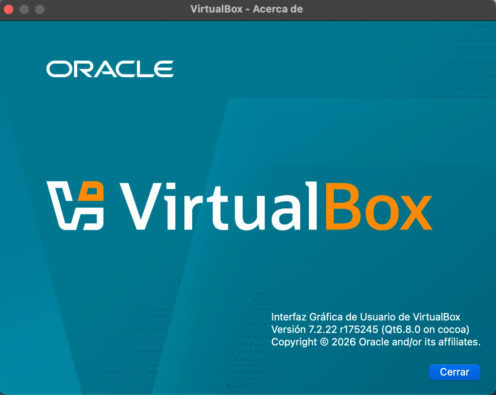{width=55%}

# Diagrama de la implementación

{width=100%}

## Direccionamiento y nombres

| Equipo | Nombre | Interfaz | Dirección | Uso |
|-----|----|------|--------|-----------|
| Host (Mac) | — | `bridge100` | 192.168.56.1/24 | Cliente (navegador, FileZilla, ssh); resuelve `lab5uvg.duckdns.org` con `/etc/hosts` |
| web01 | `web01` | `enp0s8` (NAT) | 10.0.2.15 (DHCP de VirtualBox) | Salida a internet (paquetes, Let's Encrypt, DuckDNS) |
| web01 | `web01` | `enp0s9` (host-only) | 192.168.56.11/24 fija, sin gateway | Red del laboratorio |
| db01 | `db01` | `enp0s8` (NAT) | 10.0.2.15 (DHCP de VirtualBox) | Salida a internet (paquetes) |
| db01 | `db01` | `enp0s9` (host-only) | 192.168.56.12/24 fija, sin gateway | Red del laboratorio |

| Servicio | Equipo y puerto | Acceso permitido |
|----------|-----------|----------|
| HTTPS (sitio WordPress) | web01:443/TCP | Cualquiera |
| HTTP (solo redirige a HTTPS) | web01:80/TCP | Cualquiera |
| SSH y SFTP | web01:2222/TCP | Red 192.168.56.0/24 |
| SSH | db01:2223/TCP | Red 192.168.56.0/24 |
| MySQL | db01:33306/TCP, solo en 192.168.56.12 | Solo desde web01 (192.168.56.11) |

Cada VM tiene dos adaptadores. El NAT da acceso a internet para instalar paquetes y para que certbot hable con Let's Encrypt y DuckDNS, pero desde afuera no se puede iniciar una conexión hacia la VM. La red host-only es privada entre el Mac y las VM: por ella viajan la administración, el sitio y el tráfico entre capas. Como no tiene gateway, las VM nunca la usan para salir a internet.

## Cliente y servidor

Los términos cliente y servidor se usan en dos sentidos: para el **programa** que ofrece o consume un servicio y para el **ordenador** que cumple ese papel. Un mismo equipo puede ser servidor de un servicio y cliente de otro.

| Equipo | Como ordenador | Programas servidor que ejecuta | Programas cliente que ejecuta |
|----|-----|-----------|-------------|
| Mac (host) | Cliente del laboratorio | Ninguno para el laboratorio (VirtualBox es el hipervisor, no un servicio de red) | Safari (HTTP/HTTPS), FileZilla (SFTP), `ssh`/`scp`, `nc` y `curl` para las pruebas |
| web01 | Servidor web | Apache (HTTP/HTTPS), `sshd` (SSH/SFTP) | Cliente MySQL (WordPress vía PHP y la herramienta `mysql`), certbot (ACME y API de DuckDNS), `apt` |
| db01 | Servidor de base de datos | `mysqld` (MySQL), `sshd` (SSH) | `apt` (repositorios de Ubuntu) |

web01 es el mejor ejemplo del doble sentido: frente al navegador del Mac es **servidor** HTTPS, pero frente a db01 es **cliente** MySQL. Cuando WordPress arma una página, PHP abre una conexión TCP a 192.168.56.12:33306, pide los datos y con ellos responde al navegador.

# Procedimiento por etapas

Cada etapa indica qué se hizo, por qué y qué se esperaba lograr. Los scripts de apoyo mencionados están en el repositorio del grupo (anexo A); los comandos esenciales se copian aquí para que el procedimiento sea reproducible.

## Hipervisor y red host-only

**Qué se hizo.** Se instaló VirtualBox 7.2.22 para Mac Arm64 y se creó la red host-only `lab5-hostonly`. Luego se crearon las VM web01 y db01: tipo "Ubuntu (ARM 64-bit)", 2 GB de RAM, 2 CPU, disco dinámico de 20 GB, adaptador 1 NAT y adaptador 2 host-only. Todo se hizo con `VBoxManage` desde el script `scripts/vbox-crear-vms.sh`, probado antes con VM desechables:

```bash
VBoxManage hostonlynet add --name=lab5-hostonly --netmask=255.255.255.0 \
  --lower-ip=192.168.56.1 --upper-ip=192.168.56.10 --enable
VBoxManage createvm --name=web01 --platform-architecture=arm --ostype=Ubuntu_arm64 --default --register
VBoxManage modifyvm web01 --memory=2048 --cpus=2 --graphicscontroller=vmsvga --audio-enabled=off \
  --nic1=nat --nic2=hostonlynet --host-only-net2=lab5-hostonly
VBoxManage createmedium disk --filename="$HOME/VirtualBox VMs/web01/web01.vdi" --size=20480 --format=VDI
# luego storageattach del disco y de la ISO arm64; lo mismo para db01
```

**Por qué.** En macOS la red host-only usa el framework vmnet de Apple y no tiene casilla para apagar el DHCP: el límite inferior del rango es la IP del Mac (192.168.56.1) y el resto es DHCP. Se dejó un rango corto (.1 a .10) para que las IP fijas de las VM (.11 y .12) queden fuera de él y nunca choquen con una asignada por DHCP. Automatizar la creación con un script permite repetirla igual si hay que reconstruir una VM.

**Qué se esperaba.** Una red privada estable entre el host y las dos VM, independiente de la red a la que esté conectado el Mac (en el laboratorio se usó el hotspot de un celular).

{width=75%}

## Instalación de Ubuntu Server 26.04 LTS

**Qué se hizo.** En el instalador de cada VM se eligieron:

- teclado Spanish (Latin American), igual que el del host;
- en `enp0s8` (NAT), DHCP; en `enp0s9` (host-only), dirección **manual** 192.168.56.11/24 (web01) o 192.168.56.12/24 (db01), **sin gateway ni DNS**;
- el mirror `http://ports.ubuntu.com/ubuntu-ports/` (el oficial de arm64), porque el que proponía el instalador por país descargaba a 2 kB/s;
- nombre `web01` o `db01`, usuario administrador `sysadmin`;
- **Install OpenSSH server** marcado y ningún snap adicional.

La consola de VirtualBox se usó solo para la instalación y para comprobar la IP en el primer arranque. Desde ahí, todo se hizo por SSH (4.3), incluida la actualización `sudo apt update && sudo apt full-upgrade -y`.

**Por qué.** Sin gateway en la interfaz host-only, la única ruta por defecto es la del NAT, así que el tráfico a internet nunca intenta salir por la red privada. La IP fija es necesaria porque los demás componentes la referencian: el archivo hosts, los permisos de MySQL (`wp_user@192.168.56.11`) y las reglas de UFW.

{width=80%}

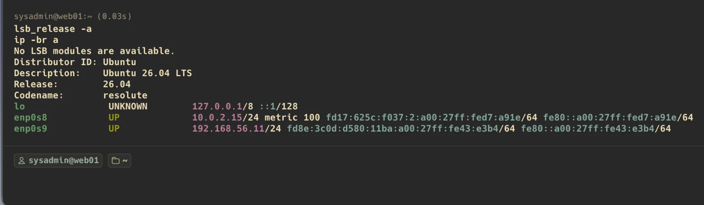

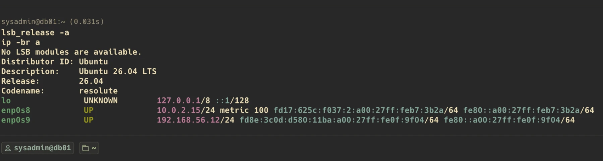

{width=85%}

## Acceso remoto por SSH

**Qué se hizo.** Desde la Terminal del Mac:

```bash
ssh sysadmin@192.168.56.11      # web01
ssh sysadmin@192.168.56.12      # db01
```

En la primera conexión se compararon las huellas de las claves del servidor (ED25519) con las que muestran las VM, y quedaron guardadas en `~/.ssh/known_hosts`:

- web01: `SHA256:jCe9XAYRrpp1+GYAqo8BGJN3+8LKuLvm+jwwn57qZSY`
- db01: `SHA256:bINWh9EcSXZDUr9ne3CCc10d07QcqwLFfsSy3BbCR3A`

Para no escribir IP y puertos cada vez, se agregó a `~/.ssh/config` del Mac (con los puertos finales de 4.10):

```text
Host web01
    HostName 192.168.56.11
    User sysadmin
    Port 2222

Host db01
    HostName 192.168.56.12
    User sysadmin
    Port 2223
```

Los scripts se copiaron a las VM con `scp` y se ejecutaron dentro de ellas por SSH. Antes de instalar servicios se tomó un snapshot `base-limpia` de cada VM, con la VM apagada (problemas 12 y 13).

**Por qué.** SSH cifra la sesión y autentica al servidor por su clave. Comparar la huella en la primera conexión evita conectarse a un equipo que se haga pasar por la VM. Administrar solo por SSH es lo que pide el objetivo de gestión remota: el servidor no necesita pantalla ni teclado, igual que en un centro de datos real.

## Capa de datos: MySQL en db01

**Qué se hizo** (script `scripts/vm/db01-mysql.sh`, ejecutado dentro de db01):

```bash
sudo apt install -y mysql-server
sudo tee /etc/mysql/mysql.conf.d/zz-lab5.cnf <<'EOF'
[mysqld]
bind-address = 192.168.56.12
port         = 33306
mysqlx       = OFF
EOF
sudo systemctl restart mysql
sudo mysql   # entra como root del motor por el socket local, sin contraseña de red
```

```sql
CREATE DATABASE wordpress_db CHARACTER SET utf8mb4 COLLATE utf8mb4_unicode_ci;
CREATE USER 'wp_user'@'192.168.56.11' IDENTIFIED BY '********';
GRANT ALL PRIVILEGES ON wordpress_db.* TO 'wp_user'@'192.168.56.11';
FLUSH PRIVILEGES;
```

La contraseña de `wp_user` se escribió en pantalla de forma oculta (`read -s`): no quedó en el script, ni en el historial, ni en el informe.

**Por qué.**

- `bind-address = 192.168.56.12`: MySQL solo escucha en la red privada; ni siquiera abre el puerto en la interfaz NAT.
- `port = 33306`: el enunciado recomienda sacar MySQL del puerto conocido 3306, que es el que prueban los escaneos automáticos.
- `mysqlx = OFF`: apaga el protocolo X (puerto 33060), que WordPress no usa. Un servicio menos expuesto.
- El archivo `zz-lab5.cnf` se agrega aparte en vez de editar `mysqld.cnf`: se lee al final y gana, y se deshace borrándolo.
- **Mínimo privilegio:** `wp_user` solo puede conectarse desde 192.168.56.11 y solo tiene permisos sobre `wordpress_db`. No es el administrador del motor, como pide el enunciado. Si alguien roba su contraseña, no le sirve desde otra máquina ni para otras bases.
- La base se administra por SSH: `sudo mysql` dentro de db01 usa el socket local, no la red.


## Capa web: Apache, PHP y WordPress en web01

**Qué se hizo** (script `scripts/vm/web01-install.sh`):

```bash
sudo apt install -y apache2 php libapache2-mod-php php-mysql php-curl php-gd php-mbstring \
  php-xml php-zip php-intl mysql-client certbot bind9-dnsutils curl
sudo a2enmod ssl rewrite headers
sudo adduser --disabled-password --comment "Administrador SFTP de WordPress" wpadmin
curl -fsSL -o latest.tar.gz https://wordpress.org/latest.tar.gz
tar -xzf latest.tar.gz && sudo cp -a wordpress/. /var/www/wordpress/
sudo chown -R wpadmin:www-data /var/www/wordpress
sudo find /var/www/wordpress -type d -exec chmod 750 {} \;
sudo find /var/www/wordpress -type f -exec chmod 640 {} \;
sudo passwd wpadmin           # contraseña para SFTP
```

**Por qué.** Apache con `mod_php` es la combinación más documentada para WordPress. Las extensiones de PHP son las que WordPress usa para la base de datos (`php-mysql`), imágenes (`gd`), textos multibyte, XML, ZIP e internacionalización. `mysql-client` lo exige el enunciado en la capa web y sirve para probar la conexión a db01 antes de configurar WordPress. Se activan `ssl` (HTTPS), `rewrite` (enlaces permanentes) y `headers`. El usuario `wpadmin` será el único con escritura sobre el sitio (sección 5).

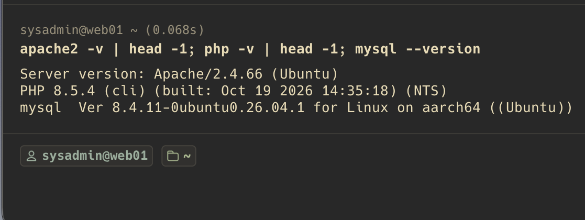{width=80%}

**Prueba entre capas.** Antes de configurar WordPress se comprobó que web01 llega a db01 con el usuario de WordPress:

```bash
mysql -h 192.168.56.12 -P 33306 -u wp_user -p wordpress_db -e "SELECT CURRENT_USER(); SHOW DATABASES;"
```


**wp-config.php.** Se generó con `scripts/vm/web01-wpconfig.sh` a partir de `wp-config-sample.php`. El script llena `DB_NAME = wordpress_db`, `DB_USER = wp_user`, la contraseña (pedida en pantalla y escapada para PHP) y `DB_HOST = 192.168.56.12:33306`, porque WordPress acepta `IP:puerto` en ese campo. También genera claves y salts aleatorias y agrega `FORCE_SSL_ADMIN` para que el panel solo funcione por HTTPS. Luego deja el archivo en `640 wpadmin:www-data` y comprueba, **como el usuario de Apache**, que PHP lo lee y se conecta a db01.

{width=90%}

## Dominio y resolución local

**Qué se hizo.** Se registró el subdominio gratuito **lab5uvg.duckdns.org** en DuckDNS, con su registro A apuntando a 192.168.56.11. En el Mac se agregó la línea al archivo hosts y se vació la caché de DNS:

```bash
echo "192.168.56.11   lab5uvg.duckdns.org" | sudo tee -a /etc/hosts
sudo dscacheutil -flushcache; sudo killall -HUP mDNSResponder
ping -c 3 lab5uvg.duckdns.org
```

**Cómo funciona.** Cuando una aplicación del Mac pide la IP de un nombre, el resolvedor del sistema (en macOS, `mDNSResponder`) consulta primero el archivo `/etc/hosts` y solo si el nombre no está ahí pregunta a un servidor DNS. Por eso el navegador llega a 192.168.56.11 sin depender de ningún DNS: la resolución es local, como pide el enunciado. La caché se vacía para que no quede guardada una respuesta anterior.

**Por qué DuckDNS.** Let's Encrypt necesita un dominio real y público para emitir el certificado (4.7). DuckDNS da uno gratis y permite publicar el registro TXT del reto DNS-01 por su API. La IP privada del registro A no estorba: desde internet nadie la usa, y en el host manda el archivo hosts.

{width=85%}

## HTTPS con Let's Encrypt (reto DNS-01)

**Métodos de validación.** Let's Encrypt solo emite un certificado a quien demuestre que controla el dominio. Tiene tres retos:

- **HTTP-01:** Let's Encrypt descarga un archivo de `http://<dominio>/.well-known/acme-challenge/` desde internet.
- **TLS-ALPN-01:** se conecta desde internet al puerto 443 del dominio.
- **DNS-01:** busca un registro TXT en `_acme-challenge.<dominio>` del DNS público.

web01 está en una red privada (host-only) a la que no se puede llegar desde internet, así que HTTP-01 y TLS-ALPN-01 son imposibles. **DNS-01** solo exige publicar un registro TXT en el DNS público del dominio, y nunca contacta al servidor web. Es compatible con la resolución local: el certificado vale para el nombre, sin importar que en el host ese nombre se resuelva por `/etc/hosts`.

**Qué se hizo.** certbot usa dos scripts propios (hooks) en `/etc/letsencrypt/duckdns/`:

- `auth.sh` publica el valor del reto con la API de DuckDNS y espera hasta ver el TXT en el DNS (en `ns1.duckdns.org` o, si la red bloquea el DNS directo, por DNS sobre HTTPS; problema 16).
- `cleanup.sh` borra el TXT al terminar.

El token de DuckDNS no va dentro de los scripts: está en `/etc/letsencrypt/duckdns/duckdns.token`, legible solo por root (carpeta 700, archivo 600). Primero se pidió un certificado de prueba en el entorno *staging* de Let's Encrypt, que no tiene límites estrictos de intentos, y después el real:

```bash
sudo certbot certonly --manual --preferred-challenges dns \
  --manual-auth-hook /etc/letsencrypt/duckdns/auth.sh \
  --manual-cleanup-hook /etc/letsencrypt/duckdns/cleanup.sh \
  -d lab5uvg.duckdns.org --agree-tos -m <correo> --no-eff-email --staging
# con "Successfully received certificate", el mismo comando sin --staging y con --force-renewal
sudo certbot certificates
```

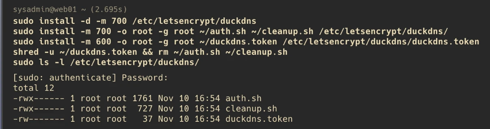{width=85%}

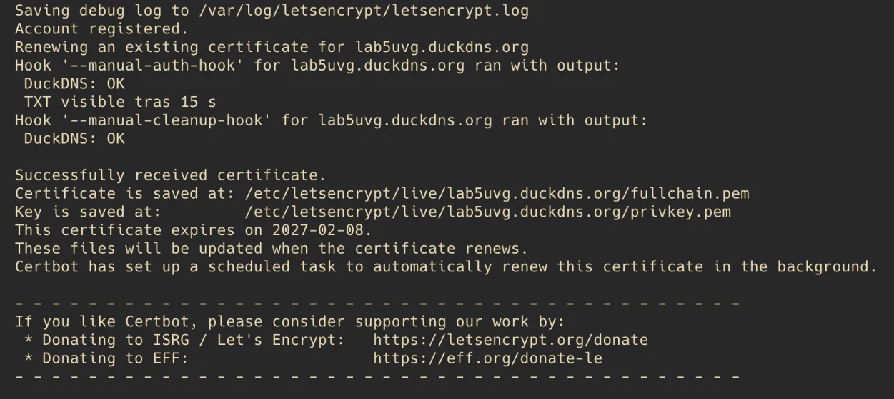{width=90%}

{width=90%}

certbot dejó programada la renovación automática y guardó los hooks en la configuración de renovación, así que el certificado se renueva sin intervención antes de vencer.

**Virtual host de Apache.** `/etc/apache2/sites-available/wordpress.conf`:

```apache
<VirtualHost *:80>
    ServerName lab5uvg.duckdns.org
    Redirect permanent / https://lab5uvg.duckdns.org/
</VirtualHost>

<VirtualHost *:443>
    ServerName lab5uvg.duckdns.org
    DocumentRoot /var/www/wordpress
    <Directory /var/www/wordpress>
        AllowOverride All
        Require all granted
    </Directory>
    SSLEngine on
    SSLCertificateFile    /etc/letsencrypt/live/lab5uvg.duckdns.org/fullchain.pem
    SSLCertificateKeyFile /etc/letsencrypt/live/lab5uvg.duckdns.org/privkey.pem
    ErrorLog  ${APACHE_LOG_DIR}/wordpress_error.log
    CustomLog ${APACHE_LOG_DIR}/wordpress_access.log combined
</VirtualHost>
```

```bash
sudo a2dissite 000-default && sudo a2ensite wordpress
sudo apache2ctl configtest && sudo systemctl reload apache2
```

El puerto 80 solo redirige a HTTPS (301), así que quien escriba `http://` termina en la conexión cifrada. `fullchain.pem` contiene el certificado y la cadena intermedia que el navegador necesita para confiar; `privkey.pem` es la clave privada y no sale de web01.

{width=90%}

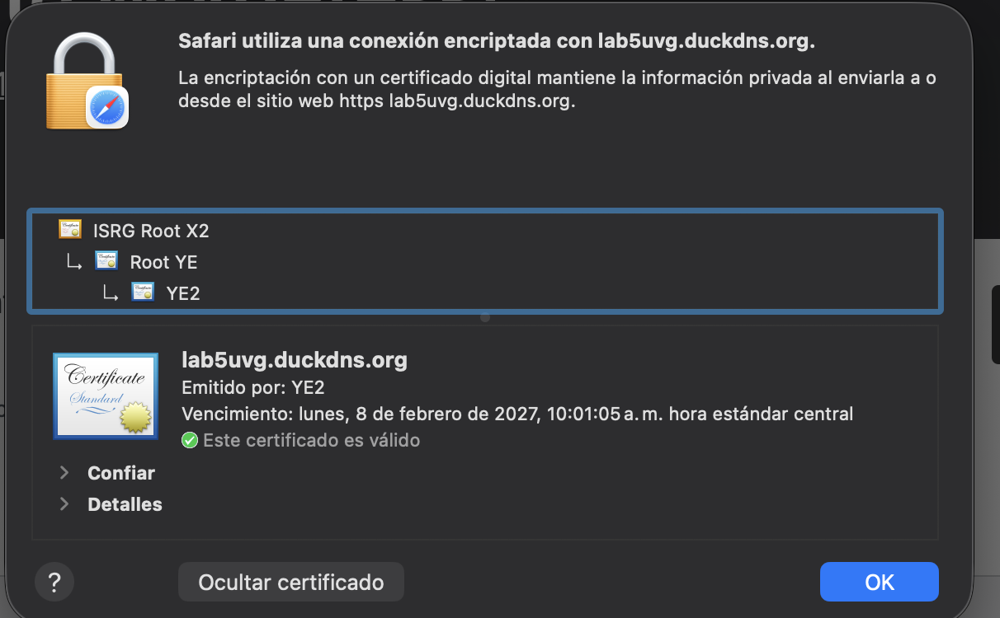{width=70%}

Desde el Mac también se revisó el certificado con `openssl` (archivo `evidencia/samuel/13b-certificado-openssl.txt`): emisor Let's Encrypt YE2, clave ECDSA P-256, nombre `DNS:lab5uvg.duckdns.org`, vigencia del 10/11/2026 al 08/02/2027 y conexión TLS 1.3. `curl` sin la opción `-k` lo acepta (verificación 0 = válido).

## Instalación de WordPress y verificación de las dos capas

**Qué se hizo.** Desde Safari en el Mac se abrió https://lab5uvg.duckdns.org y se completó el instalador de WordPress: título del sitio y un administrador del sitio cuyo nombre no es `admin` (es el nombre que prueban primero los ataques de fuerza bruta). WordPress quedó en inglés: para usar español tendría que descargar un paquete de idioma a su carpeta, y Apache no tiene permiso de escritura (sección 5).

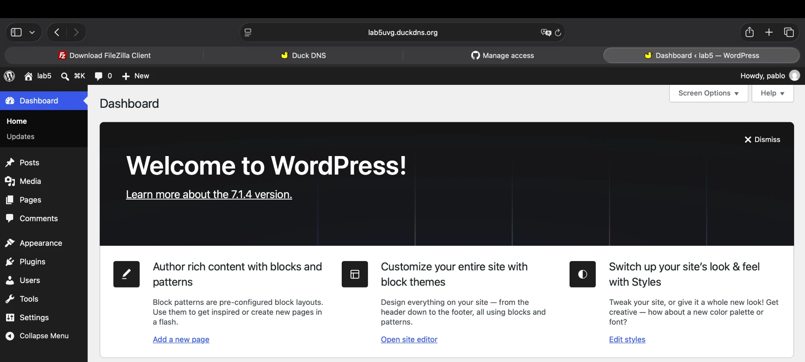{width=90%}

**Comprobación de las dos capas.** El instalador creó las tablas en la base de db01, no en web01. Se verificó por SSH dentro de db01:

```bash
ssh db01
sudo mysql -e "USE wordpress_db; SHOW TABLES;"
```

{width=60%}

## SFTP con FileZilla

**Qué se hizo.** FileZilla se conectó a web01 por **SFTP** con el usuario `wpadmin` (servidor `sftp://lab5uvg.duckdns.org`; en ese momento el puerto 22, hoy el 2222). Antes de aceptar, se comparó la huella del servidor con la de 4.3. Se subió un archivo a `/var/www/wordpress` y se abrió en el navegador. Después se repitió con el usuario `sysadmin`, que no debe poder modificar la carpeta.

**Por qué SFTP.** SFTP es un subsistema de SSH: va cifrado, usa el mismo puerto y los mismos usuarios del sistema, y no agrega un servicio FTP que haya que asegurar. Como entra con usuarios del sistema, los permisos de la sección 5 deciden qué puede hacer cada uno.

{width=70%}

{width=95%}

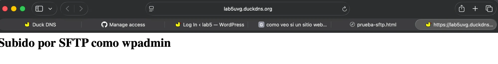{width=90%}

{width=95%}

## Puertos no conocidos y firewall UFW

**Qué se hizo.** Antes de esta etapa se tomó otro snapshot (`servicios-ok`), porque un error aquí puede dejar la VM sin acceso por SSH. El cambio se hizo con `scripts/vm/ssh-ufw.sh`, en dos fases y en el orden que evita quedarse fuera:

1. **abrir:** SSH escucha a la vez en 22 y en el puerto nuevo (2222 en web01, 2223 en db01). UFW todavía está apagado.
2. Desde una terminal **nueva** del Mac se prueba `ssh -p 2222 …`, sin cerrar la sesión anterior.
3. **cerrar:** solo se ejecuta desde la sesión que entró por el puerto nuevo (el script lo comprueba). Activa UFW y deja SSH solo en el puerto nuevo. Las sesiones abiertas no se cortan, porque UFW acepta las conexiones ya establecidas.

Lo esencial de cada fase:

```bash
# Puerto SSH (web01; en db01 es 2223)
echo "Port 2222" | sudo tee /etc/ssh/sshd_config.d/10-puerto.conf
sudo sshd -t                                  # valida la configuración
sudo systemctl daemon-reload                  # en 26.04 SSH arranca por ssh.socket:
sudo systemctl restart ssh.socket             # el socket se regenera con el Port nuevo

# Firewall (web01)
sudo ufw default deny incoming
sudo ufw default allow outgoing
sudo ufw allow from 192.168.56.0/24 to any port 2222 proto tcp
sudo ufw allow 80/tcp
sudo ufw allow 443/tcp
sudo ufw enable

# Firewall (db01)
sudo ufw default deny incoming
sudo ufw default allow outgoing
sudo ufw allow from 192.168.56.0/24 to any port 2223 proto tcp
sudo ufw allow from 192.168.56.11 to any port 33306 proto tcp
sudo ufw enable
```

**Por qué.** El puerto 22 es el más escaneado por bots. Moverlo no es una defensa por sí sola (es seguridad por oscuridad), pero reduce el ruido de ataques automáticos, como recomienda el enunciado. La defensa real es UFW: todo lo entrante se niega por defecto y solo se abre lo que se usa, desde donde se usa.

- web01 acepta HTTP y HTTPS de cualquiera, porque es el servicio público, y SSH solo desde la red privada.
- db01 acepta SSH desde la red privada y MySQL **únicamente desde web01**: aunque alguien en la red conozca el puerto 33306, no puede conectarse.
- Lo saliente queda permitido para `apt`, la renovación del certificado y la API de DuckDNS.

En Ubuntu 26.04 SSH se activa por socket (`ssh.socket`): systemd abre el puerto y arranca `sshd` cuando llega una conexión. Al recargar systemd, un generador crea el socket con los `Port` de la configuración de SSH. Por eso basta el archivo en `sshd_config.d` más `daemon-reload` y reiniciar el socket.

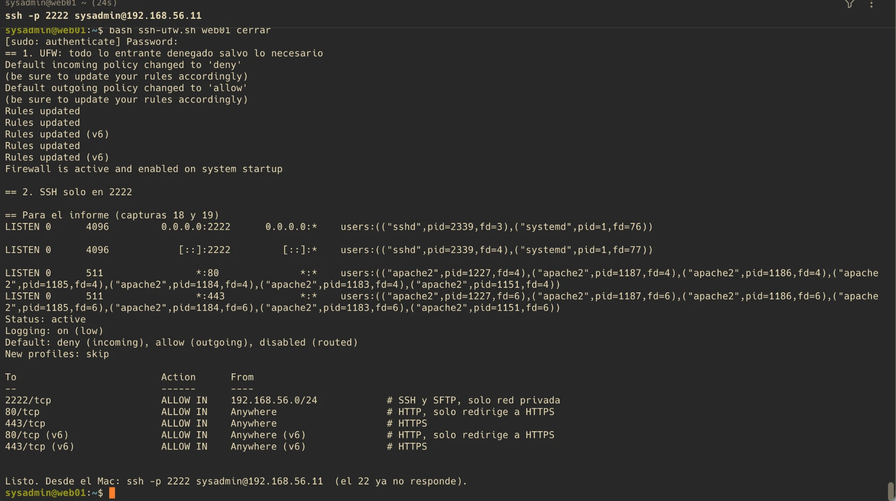

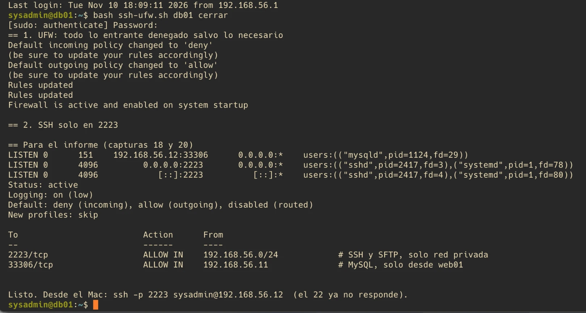

Después del cambio se actualizaron los puertos en `~/.ssh/config` del Mac (4.3) y en FileZilla (2222).

# Gestión de permisos con chmod y chown

## Dueño, grupo y otros

En Linux cada archivo tiene un **dueño** (usuario) y un **grupo**, y tres juegos de permisos: los del dueño, los del grupo y los de **otros** (cualquier otro usuario). Cada juego combina lectura (`r` = 4), escritura (`w` = 2) y ejecución (`x` = 1); el número de `chmod` es la suma por juego. En una carpeta, `x` significa poder entrar en ella y `r`, poder listar su contenido. `chown` cambia dueño y grupo; `chmod`, los permisos.

En `/var/www/wordpress` intervienen tres usuarios:

- `wpadmin`: el administrador designado; único con escritura.
- `www-data`: el usuario con que corre Apache/PHP; debe poder leer para servir el sitio.
- `sysadmin` y cualquier otro: no deben poder modificar nada.

```bash
sudo chown -R wpadmin:www-data /var/www/wordpress
sudo find /var/www/wordpress -type d -exec chmod 750 {} \;
sudo find /var/www/wordpress -type f -exec chmod 640 {} \;
```

| Tipo | Permiso | Dueño `wpadmin` | Grupo `www-data` (Apache) | Otros (sysadmin, resto) | Efecto |
|----|------|------|------|------|-------|
| Carpetas | `750` = `rwxr-x---` | 7 = `rwx`: crea, borra y renombra | 5 = `r-x`: entra y lista | 0 = `---`: no entra | Solo wpadmin cambia la estructura |
| Archivos | `640` = `rw-r-----` | 6 = `rw-`: lee y modifica | 4 = `r--`: lee para servir | 0 = `---`: nada | Solo wpadmin edita; Apache solo lee |

## Pruebas

Se intentó crear un archivo con cada usuario:

```bash
sudo -u www-data touch /var/www/wordpress/prueba.txt   # Permission denied (grupo: solo lectura)
touch /var/www/wordpress/prueba.txt                     # Permission denied (sysadmin es "otros")
sudo -u wpadmin touch /var/www/wordpress/prueba.txt     # funciona (dueño)
```


El mensaje de sysadmin dice *setting times of* en lugar de *cannot touch* porque falla antes: como "otros" tiene `---` sobre la carpeta, ni siquiera puede consultar si el archivo existe. www-data sí entra (grupo `r-x`) pero no puede escribir. La misma regla se vio en SFTP (4.9).

## Casos especiales y consecuencias

- **Archivos nuevos de wpadmin.** Toman su grupo principal (`wpadmin`), no el de la carpeta, porque las carpetas no tienen el bit setgid. Por eso `wp-config.php` se dejó explícitamente en `640 wpadmin:www-data` (problema 15): con el grupo `wpadmin`, Apache no podría leerlo. Los archivos subidos por SFTP también quedan con grupo `wpadmin`, pero con lectura para "otros", y Apache entra a las carpetas como grupo; por eso pudo servir `prueba-sftp.html` (4.9).
- **Secretos.** `wp-config.php` contiene la contraseña de la base y no es legible por "otros". El token de DuckDNS está en una carpeta `700` de root con el archivo en `600`.
- **Consecuencia aceptada.** Como Apache no puede escribir, WordPress no puede instalar plugins, temas, actualizaciones ni paquetes de idioma desde su panel, ni guardar imágenes subidas en la biblioteca de medios. Esos cambios los hace el administrador por SFTP. Es lo que exige la rúbrica (nadie más que el administrador designado escribe) y además protege el sitio: si alguien explota una vulnerabilidad de PHP, no puede modificar el código de WordPress. Un sitio en producción con subidas de usuarios abriría escritura solo en `wp-content/uploads`.

# Pruebas de funcionamiento

La tabla resume una prueba por criterio de la rúbrica. Las pruebas de red se automatizaron en `scripts/verifica-lab.sh`, que corre en el host y revisa tanto lo que debe estar abierto como lo que debe estar cerrado.

| Criterio | Prueba | Resultado esperado y obtenido | Evidencia |
|-----|----------|----------|-----|
| Despliegue en 2 capas | `ping` a ambas VM; desde web01, `mysql -h 192.168.56.12 -P 33306 -u wp_user -p`; `SHOW TABLES` en db01 | Responden; web01 entra a `wordpress_db`; las tablas `wp_*` están en db01 | 4.5, 4.8, figura de `verifica-lab.sh` |
| Versiones de SO | `lsb_release -a` en ambas | Ubuntu 26.04 LTS en las dos | 4.2 |
| Gestión remota por SSH | `ssh web01` (2222), `ssh db01` (2223); `sudo mysql` dentro de db01 | Conecta; la base se administra por SSH; la consola solo se usó en la instalación | 4.3, 4.4, 4.8 |
| SFTP y FileZilla | FileZilla como wpadmin: subir un archivo y verlo en el sitio | Sube y el cambio se ve por HTTPS | 4.9 |
| Permisos | Escritura con www-data, sysadmin y wpadmin; FileZilla con sysadmin | Solo wpadmin escribe; los demás, *Permission denied* | 5, 4.9 |
| HTTPS | Navegador y `curl` sin `-k`; `http://` | Candado y certificado Let's Encrypt válido; HTTP redirige con 301 | 4.7, `verifica-lab.sh` |
| Firewall | `ufw status verbose` en ambas; puertos desde el host | UFW activo, deny entrante; 22 cerrado; MySQL cerrado para el host | 4.10, `verifica-lab.sh` |
| Resolución local | `/etc/hosts` y `ping` por nombre | `lab5uvg.duckdns.org` → 192.168.56.11 sin consultar DNS | 4.6, `verifica-lab.sh` |

{width=85%}

# Problemas encontrados y soluciones

Los problemas se listan en el orden en que aparecieron, con su causa y la solución aplicada.

**1. Hipervisor no permitido en el host.** El Mac tenía UTM, que no está en la lista del enunciado. *Solución:* se instaló VirtualBox 7.2.22 (build Arm64) con Homebrew.

**2. Arquitecturas distintas en el grupo.** El Mac es arm64 y otro equipo del grupo es x86-64: un disco de VM de una arquitectura no arranca en la otra, y la red host-only vive dentro de un solo hipervisor. *Solución:* un solo host de demostración (el Mac), con la ISO arm64 verificada contra los SHA-256 oficiales.

**3. FileZilla no está en Homebrew.** El paquete `filezilla` ya no existe en Homebrew. *Solución:* descarga manual de la versión `macos-arm64` desde filezilla-project.org, sin el instalador con publicidad. Se verificó que estuviera firmada por el autor y notarizada por Apple.

**4. Viabilidad del reto DNS-01 con DuckDNS.** Let's Encrypt busca el TXT en `_acme-challenge.<dominio>`, no en `<dominio>`. *Solución:* antes de instalar nada se probó con `scripts/duckdns-dns01.sh` que DuckDNS responde ese subnombre con el TXT publicado (6 de 6 consultas en tres servidores DNS).

**5. Token de DuckDNS dentro de los scripts.** Las plantillas originales obligaban a pegar el token en el hook, donde quedaba en el historial y en un archivo legible. Quien tiene el token controla el DNS del dominio. *Solución:* los hooks leen el token de un archivo solo de root; la copia temporal se borró con `shred`, y en el Mac el token vive fuera del control de versiones.

**6. No existe el tipo de SO "Ubuntu 26.04" en VirtualBox.** La lista del hipervisor es anterior a esa versión. *Solución:* tipo genérico "Ubuntu (ARM 64-bit)", que solo ajusta valores por defecto (EFI, controlador VirtioSCSI, video VMSVGA). La VM arrancó el instalador sin problemas.

**7. La red host-only de macOS no tiene opción para apagar el DHCP.** En macOS VirtualBox usa vmnet de Apple: el límite inferior del rango es la IP del Mac y el resto es DHCP. *Solución:* rango .1 a .10 e IP fijas .11 y .12 fuera de él (4.1).

**8. VM pausadas por el reposo del Mac.** A mitad de la instalación las VM quedaron en pausa (*paused due to host power management*) y no se podían reanudar. El Mac había entrado en reposo con la batería. *Solución:* guardar el estado (`VBoxManage controlvm <vm> savestate`), arrancarlas de nuevo y trabajar con el cargador conectado y `caffeinate`.

**9. Reloj atrasado después de la pausa.** `apt` rechazó los índices: *Release file is not valid yet*. El reloj de las VM se detuvo durante la pausa y quedó unas 2 h atrás. *Solución:* apagar y arrancar las VM para que tomen la hora del host, y repetir la instalación.

**10. Mirror lento.** El mirror que eligió el instalador por país descargaba a unos 2 kB/s. *Solución:* usar `ports.ubuntu.com`, la ubicación oficial de los paquetes arm64; la misma prueba tardó 1 a 2 s.

**11. Distribución de teclado.** El instalador proponía inglés (EE. UU.) y el host usa español latinoamericano. *Solución:* elegir Spanish (Latin American) en ambas VM, para que la contraseña escrita en la consola coincidiera con la escrita por SSH.

**12. Snapshots en vivo fallidos.** `VBoxManage snapshot … take --live` tardó más de 20 min y falló con `VERR_SSM_TOO_MANY_PASSES`: el guardado en vivo copia la RAM mientras la VM sigue escribiéndola y no converge, sobre todo en VirtualBox para ARM. *Solución:* tomar los snapshots con la VM apagada; solo guardan el disco y son instantáneos.

**13. VM congeladas e inaccesibles después del snapshot fallido.** web01 aparecía "running" pero no respondía: el log mostraba que su CPU había quedado en pausa. db01 dejó a VirtualBox sin responder y, al cerrarla, quedó *inaccesible*: el `.vbox` registraba un disco diferencial vacío de 2 MB como hijo del disco base. *Solución:*

- se apagó web01 a la fuerza;
- se cerró el proceso colgado de db01;
- se quitó del `.vbox` la entrada del disco hijo (con respaldo previo) y se movió ese archivo fuera;
- con las dos apagadas se tomó el snapshot `base-limpia`, se arrancaron sin ventana y se comprobaron sus huellas SSH.

No se perdieron datos: el disco real no se tocó.

**14. `ls` con *Permission denied* en la prueba de permisos.** El `ls` corría como sysadmin, que no puede entrar a una carpeta `750` ajena. Era el resultado correcto, no una falla. *Solución:* listar con `sudo` o como wpadmin.

**15. `wp-config.php` ilegible para Apache si se sigue la guía al pie de la letra.** La guía creaba el archivo con `sudo -u wpadmin cp …`: la copia queda `640 wpadmin:wpadmin` y Apache no podría leerla. Sin setgid en las carpetas, un archivo nuevo toma el grupo principal de quien lo crea. *Solución:* después de crearlo, `chown wpadmin:www-data` y `chmod 640`; el script además comprueba que www-data lo lee. Se detectó antes de que fallara.

**16. DNS directo bloqueado por la red del host.** Al probar los hooks, las consultas DNS a `ns1.duckdns.org`, 1.1.1.1 y 8.8.8.8 daban *timed out*, aunque la API de DuckDNS respondía `OK`. El Mac estaba en el hotspot de un celular, que solo deja usar su propio DNS. Las VM salen por el NAT del Mac, así que web01 tenía el mismo problema. *Solución:* `auth.sh` comprueba el TXT en `ns1.duckdns.org` y, si no responde, por DNS sobre HTTPS (`dns.google`), con un tope de 120 s. La validación de Let's Encrypt no se ve afectada, porque se hace desde sus propios servidores.

**17. FileZilla intentó FTP contra el puerto SSH.** *No se puede establecer una conexión FTP a un servidor SFTP*: el servidor había quedado escrito como `ftp://…`. *Solución:* escribirlo como `sftp://lab5uvg.duckdns.org`.

# Conclusiones

- **Separar en dos capas** permite aplicar a cada una la protección que le corresponde. La base de datos no está expuesta ni al host: solo web01 llega a MySQL, por un puerto no estándar y con un usuario que solo sirve desde esa IP y para esa base. Si la capa web fuera comprometida, el daño en la base quedaría limitado a `wordpress_db`.
- **Cliente y servidor son roles, no máquinas.** web01 es servidor HTTPS frente al navegador y cliente MySQL frente a db01; el Mac es cliente de todos los servicios. Entender quién inicia cada conexión es lo que permite escribir reglas de firewall correctas: se abre el puerto en quien recibe, y solo para quien envía.
- **Los permisos de Linux bastan para controlar quién escribe.** Con dueño `wpadmin`, grupo `www-data` y `750/640`, el administrador escribe, Apache solo lee y los demás no ven nada. El precio es que WordPress no se actualiza solo, una decisión consciente que hay que justificar.
- **La administración remota por SSH** fue suficiente para todo, incluida la base de datos con `sudo mysql`. Verificar las huellas y cambiar puertos en dos fases evitó problemas de seguridad y quedarse sin acceso.
- **La resolución local** demuestra que el sistema consulta `/etc/hosts` antes que el DNS. Combinada con el reto DNS-01, permite tener un certificado público válido para un sitio que solo existe en una red privada.
- **Lecciones prácticas:** los snapshots se toman con la VM apagada; el reposo del host pausa las VM; la red del host puede bloquear el DNS directo. Documentar cada problema con su causa hizo posible repetir el procedimiento y explicarlo.

# Fuentes consultadas

1. Canonical. *Ubuntu Server documentation*. <https://documentation.ubuntu.com/server/>
2. Canonical. *Ubuntu Server for ARM* (descarga e imágenes arm64). <https://ubuntu.com/download/server/arm>
3. Oracle. *Oracle VirtualBox User Guide*. <https://www.virtualbox.org/manual/>
4. Let's Encrypt. *Challenge Types*. <https://letsencrypt.org/docs/challenge-types/>
5. Let's Encrypt. *Staging Environment*. <https://letsencrypt.org/docs/staging-environment/>
6. Electronic Frontier Foundation. *Certbot User Guide* (plugin manual y hooks). <https://eff-certbot.readthedocs.io/en/stable/using.html>
7. DuckDNS. *Spec* (API de actualización y registros TXT). <https://www.duckdns.org/spec.jsp>
8. Oracle. *MySQL 8.4 Reference Manual* (`bind_address`, `CREATE USER`, `GRANT`). <https://dev.mysql.com/doc/refman/8.4/en/>
9. WordPress.org. *Requirements*. <https://wordpress.org/about/requirements/>
10. WordPress.org. *Hardening WordPress* y *wp-config.php* (Advanced Administration Handbook). <https://developer.wordpress.org/advanced-administration/>
11. The Apache Software Foundation. *Apache HTTP Server 2.4 Documentation* (virtual hosts, `mod_ssl`). <https://httpd.apache.org/docs/2.4/>
12. OpenBSD. *sshd_config(5)* y *sftp-server(8)*. <https://man.openbsd.org/sshd_config>
13. freedesktop.org. *systemd.socket* (activación por socket). <https://www.freedesktop.org/software/systemd/man/latest/systemd.socket.html>
14. Ubuntu Community Help Wiki. *UFW*. <https://help.ubuntu.com/community/UFW>
15. FileZilla Project. *FileZilla Wiki*. <https://wiki.filezilla-project.org/>
16. Redes Sec. 10, UVG. *Laboratorio 5: Mini Datacenter Virtualizado* (enunciado) y *Guía paso a paso del Laboratorio 5*.

# Anexo A: scripts del repositorio {.unnumbered}

Todos se probaron en el laboratorio. Ninguno contiene contraseñas ni el token: los secretos se piden en pantalla o se leen de archivos solo de root.

| Script | Dónde corre | Qué hace |
|----------|---|------------|
| `scripts/host-check.sh` | Mac | Revisa que el host tenga lo necesario (herramientas, ISO y su SHA-256) |
| `scripts/vbox-crear-vms.sh` | Mac | Crea la red host-only y las VM web01 y db01 con `VBoxManage` (tiene `--dry-run`) |
| `scripts/duckdns-dns01.sh` | Mac | Prueba previa del reto DNS-01: publica un TXT y lo busca en tres servidores DNS |
| `scripts/vm/db01-mysql.sh` | db01 | Instala MySQL, lo limita a 192.168.56.12:33306, apaga el protocolo X y crea la base y `wp_user` |
| `scripts/vm/web01-install.sh` | web01 | Instala Apache, PHP y cliente MySQL, descarga WordPress, crea wpadmin y aplica 750/640 |
| `scripts/vm/web01-wpconfig.sh` | web01 | Genera `wp-config.php` (640 wpadmin:www-data) y prueba la conexión como www-data |
| `config/duckdns/auth.sh` y `cleanup.sh` | web01 | Hooks de certbot para el reto DNS-01 con DuckDNS |
| `config/apache-wordpress.conf` | web01 | Virtual host: 80 → 301 a HTTPS y sitio en 443 |
| `scripts/vm/ssh-ufw.sh` | web01 y db01 | Cambia el puerto SSH en dos fases y configura UFW |
| `scripts/verifica-lab.sh` | Mac | Batería de pruebas positivas y negativas desde el host |
